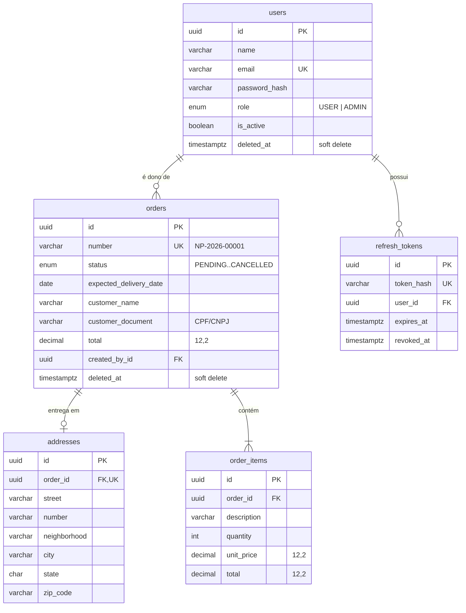

# naPorta API

Web API da **naPorta** para gestão de pedidos de entrega, construída com NestJS, Prisma e PostgreSQL.

> **Status do projeto:** Módulos 0 e 1 concluídos — fundação e camada de dados.
> A base está pronta (configuração, ambiente validado, Docker, lint, testes, health checks) e o
> modelo de dados já está criado e migrado no Postgres. Autenticação (Módulo 2) e o CRUD de
> pedidos (Módulo 3) vêm a seguir.

---

## Stack

| Camada            | Tecnologia                                                 |
| ----------------- | ---------------------------------------------------------- |
| Runtime           | Node.js 24 (ESM)                                           |
| Linguagem         | TypeScript 6.0 (`strict`)                                  |
| Framework         | NestJS 12                                                  |
| ORM               | Prisma 7 (client gerado em TypeScript, sem engine Rust)    |
| Banco             | PostgreSQL 16 (Docker Compose)                             |
| Testes            | Vitest 5 (unit + e2e com Supertest)                        |
| Lint / Formatação | ESLint 10 (flat config, com type-checking) + Prettier 3    |
| Logs              | nestjs-pino (JSON em produção, legível em desenvolvimento) |
| Documentação      | OpenAPI / Swagger (Módulo 7)                               |

---

## Pré-requisitos

- Node.js >= 20.19 (testado no 24.16)
- Docker + Docker Compose
- npm 11

---

## Como executar

### 1. Subir o banco de dados

```bash
docker compose up -d
```

Sobe o PostgreSQL 16 em `localhost:5432` (volume nomeado `naporta-db-data`).
Se a porta 5432 estiver ocupada, defina `DB_HOST_PORT` no `.env` (ver [Variáveis de ambiente](#variáveis-de-ambiente)).

### 2. Configurar o ambiente

```bash
cp .env.example .env
```

### 3. Instalar as dependências

```bash
npm install
```

O `postinstall` já executa `prisma generate` (gera o Prisma Client em `src/generated/prisma`).

### 4. Subir a API

```bash
npm run prisma:migrate:dev   # aplica as migrations no banco de desenvolvimento
npm run dev
```

A API fica disponível em **http://localhost:3000/api/v1**.

### Verificação rápida

```bash
curl http://localhost:3000/api/v1/health        # liveness  (não depende do banco)
curl http://localhost:3000/api/v1/health/ready  # readiness (verifica o banco)
```

```jsonc
// GET /api/v1/health
{
  "status": "ok",
  "service": "naporta-api",
  "version": "0.1.0",
  "environment": "development",
  "uptimeSeconds": 12.34,
  "timestamp": "2026-10-22T04:46:51.246Z",
}
```

```jsonc
// GET /api/v1/health/ready
{
  "status": "ok",
  "info": { "database": { "latencyMs": 14, "responseTime": 14, "status": "up" } },
  "error": {},
  "details": { "database": { "latencyMs": 14, "responseTime": 14, "status": "up" } },
}
```

Com o banco parado, o `/health` continua respondendo `200` e o `/health/ready` responde `503` — é assim que o orquestrador sabe que a API não deve receber tráfego.

---

## Scripts

| Script                            | Descrição                                     |
| --------------------------------- | --------------------------------------------- |
| `npm run dev`                     | API em modo watch (`nest start --watch`)      |
| `npm run build`                   | Compila para `dist/`                          |
| `npm run start:prod`              | Executa o build (`node dist/main.js`)         |
| `npm run lint`                    | ESLint (falha se houver warning)              |
| `npm run lint:fix`                | ESLint com autofix                            |
| `npm run format` / `format:check` | Prettier                                      |
| `npm test`                        | Testes unitários                              |
| `npm run test:cov`                | Testes unitários + cobertura                  |
| `npm run test:e2e`                | Testes e2e (Supertest)                        |
| `npm run prisma:generate`         | Gera o Prisma Client                          |
| `npm run prisma:migrate:dev`      | Cria/aplica migration em desenvolvimento      |
| `npm run prisma:migrate`          | Aplica migrations (produção)                  |
| `npm run prisma:studio`           | Prisma Studio                                 |
| `npm run seed`                    | Popula o banco com dados fictícios (Módulo 4) |

---

## Testes

```bash
# Unitários (não precisam de banco)
npm test

# E2E (precisam do banco de testes)
docker compose --profile test up -d db-test
npm run test:e2e
```

O banco de testes (`naporta_test`) é isolado do banco de desenvolvimento e roda na porta `5433` por padrão.

---

## Variáveis de ambiente

Todas as variáveis são validadas com Joi **antes** do container de DI subir: se algo estiver errado, a aplicação morre na inicialização com uma mensagem explícita.

| Variável                 | Padrão                  | Descrição                                     |
| ------------------------ | ----------------------- | --------------------------------------------- |
| `NODE_ENV`               | `development`           | `development` \| `test` \| `production`       |
| `PORT`                   | `3000`                  | Porta da API                                  |
| `API_PREFIX`             | `api`                   | Prefixo global das rotas                      |
| `API_VERSION`            | `1`                     | Versão da API (URI versioning)                |
| `DB_HOST_PORT`           | `5432`                  | Porta **no host** do banco de desenvolvimento |
| `DB_TEST_HOST_PORT`      | `5433`                  | Porta **no host** do banco de testes          |
| `DATABASE_URL`           | URL local               | String de conexão do PostgreSQL               |
| `DATABASE_URL_TEST`      | —                       | String de conexão do banco de testes e2e      |
| `JWT_SECRET`             | segredo de dev          | Segredo do access token (mín. 32 chars)       |
| `JWT_EXPIRES_IN`         | `15m`                   | Validade do access token                      |
| `JWT_REFRESH_SECRET`     | segredo de dev          | Segredo do refresh token (mín. 32 chars)      |
| `JWT_REFRESH_EXPIRES_IN` | `7d`                    | Validade do refresh token                     |
| `CORS_ORIGINS`           | `http://localhost:3000` | Origens permitidas (separadas por vírgula)    |
| `THROTTLE_TTL`           | `60000`                 | Janela do rate limit (ms)                     |
| `THROTTLE_LIMIT`         | `100`                   | Requisições por janela                        |
| `LOG_LEVEL`              | `info`                  | Nível do log                                  |

Em `production`, `DATABASE_URL`, `JWT_SECRET` e `JWT_REFRESH_SECRET` são **obrigatórios**, os dois segredos precisam ser diferentes entre si e os valores de desenvolvimento são recusados.

---

## Formato de erro

Todas as respostas de erro seguem o mesmo contrato:

```json
{
  "statusCode": 404,
  "error": "Not Found",
  "message": "Pedido não encontrado",
  "path": "/api/v1/orders/abc",
  "timestamp": "2026-10-22T04:46:51.246Z",
  "requestId": "42"
}
```

Erros conhecidos do Prisma são traduzidos automaticamente (`P2002` → 409, `P2025` → 404, `P2003` → 400, erros de conexão → 503).

---

## Modelo de dados



| Modelo           | Papel                                                                                               |
| ---------------- | --------------------------------------------------------------------------------------------------- |
| `users`          | Usuários da API (hash de senha, papel `USER`/`ADMIN`, soft delete)                                  |
| `orders`         | Pedidos — número de negócio único **global** (`NP-2026-00001`), status, cliente, total, soft delete |
| `addresses`      | Endereço de entrega do pedido (1:1)                                                                 |
| `order_items`    | Itens do pedido (1:N), preço em `Decimal(12,2)`                                                     |
| `refresh_tokens` | Refresh tokens rotativos e revogáveis (hash do token, nunca o token)                                |
| `order_counters` | Contador anual para o número sequencial do pedido                                                   |

**Exclusão lógica:** os modelos `Order` e `User` têm `deleted_at`. Uma extensão do Prisma
(`src/modules/prisma/prisma.extensions.ts`) aplica a regra de forma transparente:

- leituras (`findMany`, `findUnique`, `count`…) ignoram registros excluídos;
- `update` só alcança registros ativos;
- `delete`/`deleteMany` marcam `deleted_at` em vez de apagar a linha.

**Número do pedido:** sequencial anual (`NP-AAAA-NNNNN`) atribuído com um _upsert atômico_
(`INSERT ... ON CONFLICT ... RETURNING`), o que garante que duas requisições simultâneas nunca
recebam o mesmo número.

---

## Estrutura do projeto

```
src/
├── main.ts                      # bootstrap: helmet, CORS, versionamento, pipes
├── app.module.ts                # módulo raiz
├── app.setup.ts                 # pipeline compartilhado entre dev e e2e
├── common/
│   ├── errors/                  # mapeamento de erros do Prisma → HTTP
│   ├── filters/                 # filtro global de exceções
│   └── utils/
├── config/                      # env tipado, validação (Joi) e namespaces
└── modules/
    ├── health/                  # liveness + readiness
    ├── orders/                  # numeração sequencial do pedido
    └── prisma/                  # PrismaService + extensão de soft delete
prisma/
├── schema.prisma                # modelo de dados
└── migrations/                  # migrations versionadas
test/                            # testes e2e e de integração
```

---

## Decisões técnicas (resumo)

| Tema                      | Decisão                                                                              | Por quê                                                                                                                                                 |
| ------------------------- | ------------------------------------------------------------------------------------ | ------------------------------------------------------------------------------------------------------------------------------------------------------- |
| **ESM**                   | Projeto em ESM (`"type": "module"`)                                                  | O ecossistema NestJS 12 (`@nestjs/config` v12, `@nestjs/terminus` v12) é ESM-first; manter CommonJS exigiria versões antigas dos pacotes.               |
| **Prisma 7**              | Client gerado como TypeScript em `src/generated/prisma`                              | Sem engine binário (client "Rust-free"), mais rápido no cold start e com os tipos no repositório. `prisma.config.ts` centraliza URL, migrations e seed. |
| **TypeScript 6**          | `module: nodenext`, `allowImportingTsExtensions` + `rewriteRelativeImportExtensions` | Imports relativos usam `.js` (padrão ESM/Node) e o client gerado pelo Prisma usa `.ts`, reescrito para `.js` no build.                                  |
| **Vitest + SWC**          | `unplugin-swc` no lugar do esbuild                                                   | O Nest depende de `emitDecoratorMetadata`, que o esbuild não implementa.                                                                                |
| **Configuração única**    | `src/app.setup.ts`                                                                   | `main.ts` e o setup dos testes e2e usam o mesmo pipeline — evita divergência entre dev e teste.                                                         |
| **Validação de ambiente** | Joi no boot                                                                          | Falha rápido e com mensagem clara, em vez de erro em produção.                                                                                          |
| **Soft delete**           | Extensão do Prisma                                                                   | Registro excluído nunca vaza por uma leitura "esquecida" de filtro, e `delete` nunca apaga a linha fisicamente.                                         |
| **Número do pedido**      | Upsert atômico no Postgres                                                           | Sem lock explícito: a atomicidade vem do próprio banco (`ON CONFLICT ... RETURNING`).                                                                   |
| **Dinheiro**              | `Decimal(12,2)` no banco                                                             | Precisão exata; a serialização para `number` acontece na borda (Módulo 3).                                                                              |
| **IDs**                   | UUID v4                                                                              | Evita IDs sequenciais e, com isso, enumeração de registros.                                                                                             |

A seção completa de decisões e justificativas (com diagramas de arquitetura e ER) entra no **Módulo 7**.

---

## Docker

O Módulo 0 sobe apenas o banco. A imagem da API (multi-stage, usuário não-root, healthcheck) entra no **Módulo 6**.

```bash
docker compose up -d                    # banco de desenvolvimento
docker compose --profile test up -d db-test   # banco de testes
docker compose down                     # remove os containers (o volume persiste)
docker compose down -v                  # remove também os volumes
```
